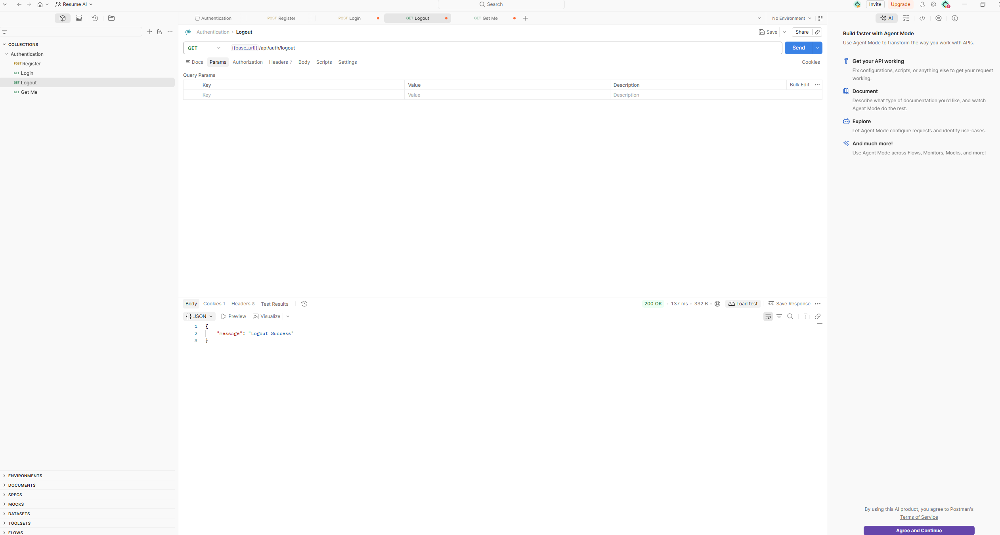

# CareerPilot

CareerPilot will be a full-stack, generative AI-powered job preparation application designed to help users optimize their resumes and prepare for interviews. Development is currently in the early backend stage, with user authentication as the first implemented feature set.

## Current Progress

- Express application and development server are set up.
- MongoDB connection is configured with Mongoose.
- User schema includes a unique username, unique email, and password.
- Registration checks required fields and existing users, hashes passwords with bcrypt, creates a user, and issues a JWT in a cookie.
- Login checks credentials, compares the password hash, and issues a JWT in a cookie.
- Logout clears the token cookie and stores the token in a MongoDB blacklist.
- Authentication middleware checks the blacklist, verifies the JWT, and attaches its decoded payload to `req.user` for protected routes.
- The `GET /api/auth/getme` endpoint uses that payload to fetch and return the logged-in user's profile.
- Register, login, logout, and get-me flows have been tested with Postman.

The current codebase is an in-progress backend foundation; the full application, frontend, and AI-powered resume and interview preparation features are still under development.

## Current Backend Stack

- Node.js and Express 5
- MongoDB and Mongoose
- bcrypt for password hashing
- JWT for authentication
- Cookies for delivering the token
- nodemon for local development

## Planned Application Stack

- Frontend: React.js
- Backend: Node.js and Express.js
- Authentication: JWT with server-side token blacklisting for logout/revocation
- Generative AI: Gemini API
- PDF generation: Puppeteer

The React frontend, Gemini integration, and Puppeteer-based PDF generation are planned and are not implemented in the current codebase yet. MongoDB currently stores blacklisted tokens; Redis could be considered later if blacklist lookup throughput becomes a bottleneck.

## Getting Started

### Requirements

- Node.js and npm
- A MongoDB connection string

### Install and configure

```bash
npm install
```

Create a `.env` file in the project root with:

```env
MONGODB_URI=your_mongodb_connection_string
JWT_SECRET=use_a_long_random_secret
```

Start the development server:

```bash
npm run dev
```

The server listens on port `3000`.

## Authentication API

Base path: `/api/auth`

### Register

`POST /api/auth/register`

JSON body:

```json
{
  "username": "jordan",
  "email": "jordan@example.com",
  "password": "your-password"
}
```

On success, returns HTTP `201`, a success message, the new user's ID, username, and email, and sets a `token` cookie. Missing fields or an existing email/username return HTTP `400`.

### Login

`POST /api/auth/login`

JSON body:

```json
{
  "email": "jordan@example.com",
  "password": "your-password"
}
```

On success, returns HTTP `200`, a success message, the user's ID, username, and email, and sets a `token` cookie. Missing fields or invalid credentials return HTTP `400`.

## Today's Work (October 19, 2026)

The authentication endpoints have been tested with Postman.

### Register


### Login


### Get Me: Authenticated Profile

`GET /api/auth/getme` is a protected route. The authentication middleware reads the `token` cookie, rejects blacklisted or invalid tokens, verifies the JWT, and assigns its decoded payload to `req.user`. The controller then looks up the full user record and returns the user's ID, username, and email.


If the token has been blacklisted, the middleware rejects the request with HTTP `401`.


### Logout and Token Revocation

`GET /api/auth/logout` stores the cookie token in the MongoDB blacklist (when a token is present), clears the `token` cookie, and returns a success message. Protected routes reject tokens found in the blacklist, so clearing the cookie is paired with server-side revocation.


The current blacklist is stored in MongoDB. Redux is client-side application state and is not an appropriate trusted store for server-side token revocation. If higher blacklist lookup throughput is needed, Redis is a possible server-side alternative.

## Learning Context

This project is a hands-on opportunity to strengthen backend development skills, including REST API design, authentication middleware, JWT validation, and server-side token revocation. It also explores how to test authentication flows and distinguish between clearing a client cookie and invalidating a token on the server.

## Project Structure

```text
server.js
src/
  app.js
  config/
    database.js
  controllers/
    auth.controller.js
  middleware/
    auth.middleware.js
  models/
    blacklist.model.js
    user.model.js
  routes/
    auth.route.js
```

## Next Steps

- Add automated tests and validate authentication edge cases, including missing tokens and blacklist lookup failures.
- Set appropriate cookie security options, including `httpOnly`, `secure` in production, and a deliberate `sameSite` policy.
- Build the frontend for the full-stack application.
- Add AI-powered resume optimization and interview preparation features.